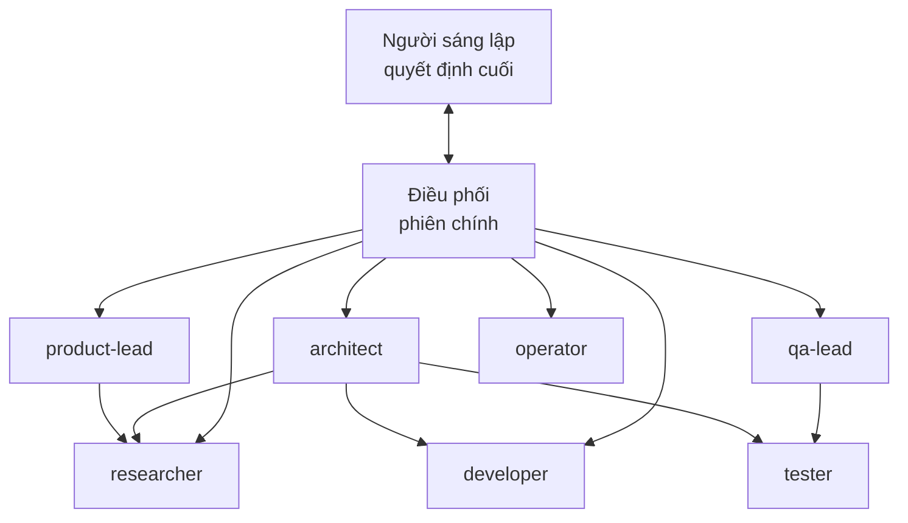

# Sơ đồ tổ chức

Cập nhật: 26/9/2026 · Thêm, sửa hoặc cắt vai trò bằng `/hire-role` và `/retire-role`. Bảng dưới là **sổ đăng ký chính thức**: vai trò nào không có trong bảng thì không tồn tại.

## Mô hình

- **Điều phối** (phiên chính, không có file vai trò):
  - nói chuyện với Người sáng lập
  - chia việc, gọi đúng vai trò
  - tổng hợp báo cáo, giữ `docs/progress.md`
  - việc nhỏ dưới vài phút thì tự làm, không cần giao
- **Quản lý:** dựng khung, đề xuất, duyệt. **Được giao lại việc** cho thực thi (quy tắc ở [playbooks/delegation.md](playbooks/delegation.md)). Có bộ nhớ riêng để nhớ việc đang theo dõi.
- **Thực thi:** làm, test, báo cáo. Không tự đổi phạm vi, không quyết định sản phẩm.
- **Chỉ tốn token khi được gọi.** Một vai trò không dùng tới chỉ là một file `.md` nằm yên.

## Sổ đăng ký vai trò

| Vai trò | Tầng | Cấp | Model | Bộ nhớ | Công cụ chính | Gọi khi |
|---|---|---|---|---|---|---|
| `product-lead` | công ty | Quản lý | opus | project | đọc, web, ghi docs, giao việc | Có ý tưởng mới, cần chọn hướng, ưu tiên, cân nhắc đánh đổi, soạn đề xuất quyết định |
| `architect` | công ty | Quản lý | opus | project | đọc, web, ghi docs, bash, giao việc | Cần dựng khung kỹ thuật, kế hoạch triển khai, chia việc, chọn công nghệ, đổi cấu trúc thư mục |
| `qa-lead` | công ty | Quản lý | opus | project | đọc, bash, giao việc, ghi bộ nhớ (không sửa sản phẩm) | Cổng chất lượng (hiến pháp §5): duyệt ĐẠT/CHƯA ĐẠT trước khi báo "xong" |
| `researcher` | công ty | Thực thi | sonnet | — | đọc, web, ghi docs nghiên cứu, bash (clone, liệt kê) | Tìm hiểu công nghệ, dịch vụ, đối thủ, repo; tổng hợp có nguồn |
| `developer` | công ty | Thực thi | sonnet | — | đọc, ghi, bash | Viết hoặc sửa code theo kế hoạch đã duyệt |
| `tester` | công ty | Thực thi | sonnet | — | đọc, ghi test, bash | Viết và chạy test, tái hiện lỗi, đo kết quả |
| `operator` | công ty | Thực thi | haiku | — | bash, đọc | Chạy việc máy móc đã có sẵn lệnh: chạy lô, tải, chuyển đổi, đổi tên hàng loạt |
| `llm-runner` | dự án | Thực thi | haiku | — | bash, đọc, ghi kết quả | Chạy model LLM ngoài rẻ hoặc miễn phí (GLM) theo lô, so sánh số liệu giữa các lượt chạy |

Gói ngành: chưa có. Thêm khi dự án cần, ví dụ `media-scriptwriter` cho gói `media`.

## Chọn model
- **haiku:** làm theo lệnh có sẵn, không cần suy luận.
- **sonnet:** viết code, nghiên cứu, test. Đây là mặc định cho thực thi.
- **opus:** quyết định, kiến trúc, review, việc mơ hồ.
- Điều phối được chỉ định model khác khi giao việc nếu việc đó dễ hoặc khó bất thường.

## Mở rộng và thu gọn
- **Thêm vai trò** khi có một loại việc lặp lại mà vai trò hiện có làm kém hoặc tốn. Không thêm cho việc một lần.
- **Cắt vai trò** khi 2 vai trò chồng phạm vi, hoặc vai trò không được gọi suốt một giai đoạn dài.
- **Mở rộng quyền** (thêm công cụ, thêm quyền trong `settings.json`) phải được Người sáng lập duyệt và ghi vào `docs/decisions.md` của dự án.
