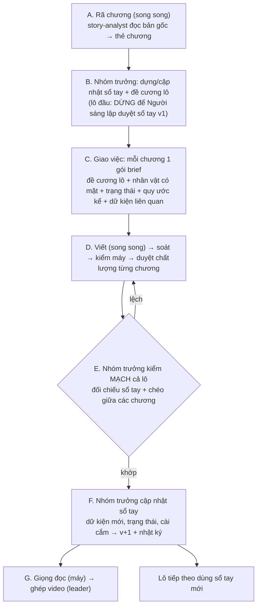

# Sổ tay truyện và dây chuyền theo lô: giữ nhất quán khi nhiều agent cùng viết

Cập nhật: 26/9/2026 · Trạng thái: **Người sáng lập đã duyệt (lô 5 chương, lô đầu dừng chờ duyệt sổ tay); đã code trong `src/run.py`, 35 test pass, chưa chạy thật, chưa qua QA**

## 1. Vấn đề
Pipeline hiện tại cho mỗi chương một agent viết riêng. Các agent chỉ chung nhau bảng tên và tóm tắt chương trước, nên sai lệch tích dần theo số chương:
- **Xưng hô trôi:** chương 1 gọi nhân vật chính là "anh", chương 3 thành "hắn".
- **Sự kiện lệch:** chương 5 nói nhân vật có 300 tệ, chương 7 lại thành 500 tệ; ai biết bí mật gì, từ lúc nào.
- **Trạng thái nhân vật không theo dõi:** năng lực, tài sản, quan hệ.
- **Cài cắm bị quên:** chương 2 cài một chi tiết, chương 40 trả lại thì agent viết chương 40 không biết đó là chi tiết đã cài.
- **Lời bình lộ trước:** người kể nói điều mà người nghe tới chương sau mới được biết.

Viết lại truyện có sẵn đỡ hơn tự sáng tác, vì bản gốc là căn cứ cuối cùng. Nhưng mỗi agent diễn đạt lại một kiểu, nên sai lệch vẫn xảy ra.

## 2. Cách các dự án viết truyện giải quyết
Ba repo đã nghiên cứu trong [novel-writing-repos.md](../research/novel-writing-repos.md), cộng với khái niệm của các công cụ viết truyện thương mại:
- **Long-Novel-GPT: 3 tầng.** Đại cương → dàn ý chương → văn. Tầng dưới chỉ được viết trong khuôn tầng trên.
- **AI_NovelGenerator: giữ mạch truyện dài.** Sau mỗi chương cập nhật bản tóm tắt cuộn và **trạng thái nhân vật** (đồ vật, năng lực, quan hệ, sự kiện đã xảy ra). Trước khi viết, đánh dấu [!] chỗ mâu thuẫn.
- **pikachuNovel: rã truyện thành đoạn.** Mỗi đoạn tối đa 12 chương, ghi cấu trúc khởi → dồn → lật → giải quyết, tình tiết cài cắm.
- **Sudowrite "Story Bible", NovelCrafter "Codex":** một **sổ tay truyện** duy nhất (thế giới, nhân vật, quy tắc), mọi lần viết đều lấy ngữ cảnh từ đó.
- Kế hoạch kỹ thuật cũ của mình ([technical.md](technical.md) Bước 2) đã dự kiến `outline/setting.md`, `character_state.md`, `segments/`, kèm bước "dừng để duyệt khung trước khi viết". Pipeline hiện tại **chưa làm phần này**.

## 3. Nguyên tắc
1. **Một nguồn sự thật cho mỗi truyện: sổ tay truyện.** Mọi agent viết theo sổ tay. Khi sổ tay và kịch bản mâu thuẫn, sổ tay thắng. Khi sổ tay và bản gốc mâu thuẫn, bản gốc thắng và phải sửa sổ tay.
2. **Nhóm trưởng truyện giữ sổ tay.** Chỉ nhóm trưởng được sửa sổ tay. Agent viết chỉ được **đề xuất** điều mới.
3. **Không nợ:** mọi dữ kiện trong sổ tay ghi rõ **chương nguồn**. Mọi thay đổi có nhật ký kèm lý do. Mỗi kịch bản ghi rõ nó được viết theo **phiên bản sổ tay** nào.
4. **Làm theo lô** (một đoạn truyện khoảng 5–10 chương). Trong một lô thì song song; giữa các lô thì tuần tự, vì lô sau cần sổ tay đã cập nhật từ lô trước.

## 4. Sổ tay truyện (`stories/<slug>/bible/`)
| File | Nội dung | Ai cập nhật |
|---|---|---|
| `bible.md` | Tiền đề, mạch chính, quy tắc thế giới (bàn tay vàng, hệ thống), dòng thời gian lớn. **Quy ước kể**: xưng hô của người kể với từng nhân vật, cách gọi tắt, quy đổi tiền tệ, giọng lời bình | Nhóm trưởng |
| `characters.md` | Hồ sơ từng nhân vật: tính cách, cách nói, quan hệ, **trạng thái hiện tại** (tuổi, tiền, năng lực, bí mật đã biết) kèm chương nguồn | Nhóm trưởng, sau mỗi lô |
| `ledger.md` | **Sổ dữ kiện**: dữ kiện đã xác lập (ai, cái gì, chương nào); **cài cắm** (chương cài → chương trả, trạng thái mở hay đã đóng); cột **"người nghe biết từ chương"** để lời bình không lộ trước | Nhóm trưởng, sau mỗi lô |
| `arcs/NN.md` | Đề cương từng lô: cấu trúc khởi → dồn → lật → giải quyết, vai trò từng chương trong lô, điểm sướng, móc nối sang lô sau | Nhóm trưởng, trước khi viết lô đó |
| `CHANGELOG.md` | Phiên bản sổ tay: v1, v2… kèm việc thêm hay sửa gì, lý do, chương nguồn | Tự động khi nhóm trưởng cập nhật |
| `rename_map.json` (đã có) | Bảng tên Hán Việt | Gộp vào việc của nhóm trưởng |

## 5. Dây chuyền theo lô

| Bước | Ai | Model (thang) | Đầu ra | Cổng |
|---|---|---|---|---|
| A. Rã chương | story-analyst ×N | Gemini Flash → Pro | thẻ chương | kiểm máy: đúng số chương, đủ mục |
| B. Sổ tay và đề cương | **story-lead** (vai trò mới) | Gemini 3.1 Pro high → Opus 4.6 | `bible/*`, `arcs/NN.md` | **lô đầu: Người sáng lập duyệt**; các lô sau: tự động, nhưng mục sửa (không phải thêm) phải báo |
| C. Giao việc | script | — | gói brief từng chương (chỉ phần sổ tay liên quan, không nhồi cả sổ) | — |
| D. Viết, soát, duyệt | scriptwriter, editor, content-reviewer ×N | như hiện tại | `script/NNN.txt` + "đề xuất bổ sung sổ tay" | duyệt chất lượng từng chương |
| E. Kiểm mạch | **story-lead** | Opus 4.6 (đọc cả lô, cần suy luận) | danh sách lệch theo chương | lệch thì trả chương đó về D kèm ghi chú, tối đa 2 vòng |
| F. Cập nhật sổ tay | **story-lead** | Gemini 3.1 Pro high | sổ tay v+1, CHANGELOG | máy kiểm: không xoá dữ kiện cũ, mỗi dữ kiện có chương nguồn |
| G. Giọng, video | máy | VieNeu, ffmpeg | mp3, video | như hiện tại |

**Agent viết trả về hai phần:** kịch bản, và mục "Đề xuất bổ sung sổ tay" (dữ kiện, trạng thái mới gặp trong chương). Script tách riêng hai phần. Nhóm trưởng gom đề xuất của cả lô ở bước F. Nhờ đó các agent chạy song song mà không ghi đè sổ tay của nhau.

## 6. Thay đổi so với pipeline hiện tại
- Thêm vai trò `story-lead` (file vai trò trên agy) và 3 bước B, E, F trong `src/run.py`. Bước "bảng tên" gộp vào B.
- Chạy theo lô: `--chapters 1-10 --batch 5` nghĩa là 2 lô, lô sau chờ sổ tay của lô trước.
- `prev_context` lấy từ sổ tay (trạng thái, dữ kiện) thay vì chỉ thẻ chương trước.
- Người duyệt từng chương có thêm tiêu chí "đúng sổ tay: xưng hô, trạng thái, dữ kiện".
- **Lô đầu có điểm dừng** để Người sáng lập đọc sổ tay v1 và đề cương, kiểu duyệt bản thiết kế trước khi xây.

## 7. Chi phí ước tính
Mỗi lô 5 chương thêm 3 lần gọi của nhóm trưởng: B và F bằng Gemini Pro, E bằng Opus. Tổng thêm khoảng 5–8% quota Gemini và khoảng 3–5% quota Claude/GPT (trong gói agy) mỗi lô. Thời gian thêm khoảng 5–8 phút mỗi lô, bù lại được nhờ chạy song song.

## 8. Việc cần Người sáng lập chốt
1. Đồng ý thiết kế sổ tay và dây chuyền theo lô?
2. Cỡ lô mặc định: 5 chương (đề xuất) hay theo ranh giới đoạn truyện tự nhiên (nhóm trưởng tự chia)?
3. Lô đầu dừng để bạn duyệt sổ tay v1: đồng ý?
