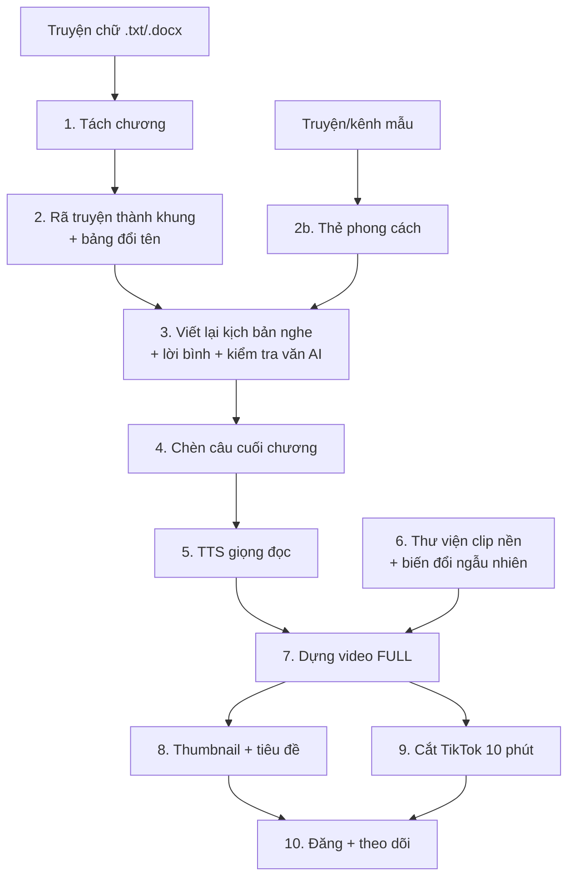

# Kế hoạch kỹ thuật: Pipeline sản xuất video truyện

Cập nhật: 25/9/2026 · Đi kèm [channel.md](channel.md) · Nghiên cứu repo tham khảo: [novel-writing-repos.md](../research/novel-writing-repos.md)

Mục tiêu: đưa vào **1 file truyện chữ**, nhận ra **1 video FULL YouTube + clip TikTok + thumbnail + tiêu đề**, với ít thao tác tay nhất. Làm MVP trước (chạy được từ đầu đến cuối), rồi nâng chất lượng từng khâu.

## 1. Tổng quan luồng

Mỗi bước ghi kết quả ra file trong thư mục truyện. Bước nào lỗi chỉ cần chạy lại bước đó, không làm lại từ đầu. Sau bước 2 (khung + bảng tên) và bước 3 (kịch bản) có **điểm dừng để bạn duyệt**.

## 2. Các module

### Bước 1. Nhập truyện và tách chương
- Đầu vào: `.txt`, `.docx` hoặc `.epub`.
- Tách theo mẫu "Chương X" / "Chapter X"; chuẩn hoá khoảng trắng, bỏ quảng cáo web truyện, bỏ dòng ký tên nhóm dịch.
- Đầu ra: `chapters/001.txt`, `chapters/002.txt`…

### Bước 2. Rã truyện thành khung (拆书) và đổi tên
Theo quy trình của pikachuNovel, bổ sung phần nhân vật và trạng thái lấy ý tưởng từ AI_NovelGenerator (chi tiết trong [novel-writing-repos.md](../research/novel-writing-repos.md) §2, §5). Chỉ lấy ý tưởng, tự viết prompt tiếng Việt, không copy code (các repo gốc dùng giấy phép GPL/AGPL hoặc không có giấy phép).

- **Thẻ chương** `outline/chapter_cards/001.json`, mỗi chương một lần gọi LLM, chạy song song. Lưu cache theo hash nội dung chương.
  - `summary` (~300–600 chữ)
  - `beats`: danh sách mốc, mỗi mốc ≤50 chữ, khớp 1–1 với văn gốc, không suy diễn. Cách này lấy từ Long-Novel-GPT.
  - `emotion_tone`, `story_line` (các mốc nối bằng "+"), `highlights` (câu đắt, điểm vả mặt), `end_hook`
  - `characters`
  - Quy tắc: không bịa chi tiết không có trong truyện. JSON sai thì gửi lỗi lại cho LLM sửa, tối đa 3 lần.
- **Đoạn truyện** `outline/segments/`: gom các thẻ thành đoạn khép kín (≤12 chương) theo ranh giới tự nhiên. Mỗi đoạn ghi: cấu trúc khởi → dồn → lật → giải quyết, điểm sướng, được và mất, tình tiết cài cắm.
- **Bản thiết lập** `outline/setting.md`:
  - thế giới, bàn tay vàng, hệ thống sức mạnh
  - hồ sơ nhân vật
  - sổ tình tiết cài cắm (chương cài → chương trả)
  - từ điển thiết lập có cột **"người nghe đã biết đến chương"**, để lời kể không tiết lộ trước
- **Trạng thái nhân vật** `outline/character_state.md`: đồ vật, năng lực, quan hệ, được cập nhật sau mỗi đoạn truyện.
- **Bảng đổi tên** `rename_map.json`: lấy từ danh sách nhân vật, địa danh, công ty, môn phái trong bản thiết lập. Tên mới theo phong cách Hán Việt, bạn duyệt. Áp nhất quán toàn truyện, kể cả biệt danh và cách gọi tắt. Con số và thương hiệu dễ nhận diện đổi luôn nếu muốn.
- **Dừng để duyệt** khung và bảng tên trước khi viết.

### Bước 2b. Thẻ phong cách (làm một lần cho cả kênh)
Theo FuFu-Novel-Writing, chuyển phép đo sang tiếng Việt.
- Nguồn mẫu: 2–3 truyện hoặc bản chép lời kênh bạn thích nghe (tự gõ, hoặc dùng Whisper chép từ audio).
- Script đo: độ dài câu và phân bố câu ngắn/dài, độ dài đoạn, tỉ lệ thoại, trợ từ (nhé/à/ạ/cơ/chứ), câu hỏi tu từ, cách xưng hô.
- LLM mô tả thành `channels/<channel>/style_card.md` theo 6 chiều: từ vựng, câu, miêu tả, thoại, nhịp, lời bình. File có mục "nét không được chép".
- Kèm vài **đoạn mẫu hay nhất** làm neo phong cách. Viết thử 300–500 chữ để hiệu chỉnh.

### Bước 3. Viết lại kịch bản nghe (仿写)
- **Đơn vị viết:** một khối tình tiết (~1 chương), theo đúng dàn ý. Dàn ý là bản thiết kế duy nhất, không thêm nhân vật hay sự kiện chính.
- **Thứ tự nội dung prompt:**
  1. bản thiết lập, trạng thái nhân vật, tóm tắt cuộn
  2. tình tiết chương này
  3. đoạn kết chương trước và đoạn mẫu phong cách, **đặt cuối cùng**
- **Mức viết lại** (chọn trong `config.yaml`):
  - `keep_plot`: giữ cốt truyện, đổi toàn bộ lời kể.
  - `alter_details`: đổi thêm chi tiết phụ, giữ khung chính.
  - Và độ dài: **kể sát** (~70–80%) hoặc **tóm tắt** (~30–50%).
- **Quy tắc riêng cho kịch bản nghe** (chưa repo nào có, phải tự thiết kế):
  - câu ngắn, rõ chủ ngữ
  - không dùng ngoặc hay ký hiệu
  - số viết ra chữ
  - ít thoại chồng chéo, luôn nói rõ ai đang nói
- **Chương 1:** có hook mở đầu 30–60 giây (đưa đoạn gay cấn nhất lên trước).
- **Lời bình người kể:** 1–2 câu ở vài điểm mỗi chương, nói trực tiếp với người nghe.
- **Cuối chương:** câu móc chọn từ 13 kiểu móc, độ căng theo sóng thấp–vừa–cao.
- **Kiểm tra sau khi viết:**
  - Script kiểm tra văn AI tiếng Việt:
    - độ dài câu quá đều (hệ số biến thiên thấp)
    - mở đoạn lặp
    - cụm từ lặp
    - cụm sáo rỗng
    - lộ từ kỹ thuật ("dàn ý", "chương sau")
    - văn bị cụt
  - LLM "biên tập viên" chấm nhịp và độ trung thành với dàn ý, chỉ viết lại chỗ lỗi, tối đa 2 vòng.
- **Đầu ra:** `script/001.txt`… → **dừng để duyệt**.
- **Chi phí LLM:** đo thực tế trên 5 chương mẫu trước khi chọn mô hình. Dùng 2 mức: mô hình rẻ cho rã truyện và kiểm tra, mô hình tốt cho viết.

### Bước 4. Câu chèn cuối chương
- Kho câu `channels/<channel>/end_lines.json`, 4 nhóm: A tự sự/bình luận (~50%), B hé lộ/giữ chân (~25%), C like/sub (~15%), D hội viên/donate/Zalo (~10%).
- Biến tự điền: `{nhan_vat}`, `{so_chuong}`, `{ten_kenh}`, `{khung_gio}`.
- Quy tắc:
    - Không lặp câu trong 1 video; không lặp trong 5 video gần nhất (lưu lịch sử `data/end_line_history.json`).
    - Nhóm C cách nhau tối thiểu 20–30 phút; nhóm D chỉ từ giữa video trở đi.
    - Chương ngắn dưới ~3 phút thì bỏ qua, gộp sang chương sau.
- Khởi đầu với ~80 câu, bổ sung dần.

### Bước 5. TTS giọng đọc
- Một giọng cố định làm thương hiệu. Các lựa chọn cần thử nghe so sánh:
    - **VieNeu-TTS** (mã nguồn mở, Apache-2.0, clone giọng, chạy CPU): ứng viên số 1.
    - FPT.AI, Vbee, Viettel AI, Gemini TTS, Azure (trả phí, dùng thương mại được).
    - ElevenLabs quá đắt cho video dài.
    - Chi tiết giá ở [ai-services.md](../research/ai-services.md) §5.
- **edge-tts chỉ dùng để thử nghiệm nội bộ.** Microsoft không cho dùng thương mại khi không có tài khoản Azure, nên không đăng video dùng edge-tts lên kênh kiếm tiền.
- Đọc theo từng chương → chuẩn hoá âm lượng (loudnorm) → ghép, đồng thời ghi lại **mốc thời gian mỗi chương** để làm chapter YouTube và biết chỗ chèn câu.
- Câu chèn cuối chương đọc chậm hơn ~5–10%, có tiếng chuyển cảnh ngắn trước đó.
- **Nhạc nền không lời:**
    - Nguồn ưu tiên: **YouTube Audio Library** (YouTube Studio → Thư viện âm thanh), lọc "Không cần ghi công", thể loại Ambient/Cinematic/Classical, tâm trạng Calm/Dramatic/Inspirational. An toàn nhất vì do chính YouTube cấp phép, dùng được cho video kiếm tiền.
    - Nguồn phụ: Pixabay Music, Incompetech (CC BY, phải ghi công), Free Music Archive (chỉ lấy bài CC BY/CC0, **tránh NC**). Kiểm tra giấy phép từng bài; một số bài trên các trang này bị tác giả đăng ký Content ID nên vẫn có thể bị claim.
    - Phương án khác: nhạc AI tự tạo (chỉ dùng gói có **quyền thương mại**).
    - Ghi công (nếu bài yêu cầu) tự động thêm vào mô tả video.
    - Kho 5–10 bài theo tâm trạng (nhẹ nhàng, hồi hộp, hào hùng); mỗi video phát ngẫu nhiên nhiều bài, nối bằng crossfade 3–5 giây để chỗ lặp không bị giật.
    - Tránh trống mạnh, giai điệu nổi bật, dải tần trùng giọng nói.
    - Âm lượng: giọng đọc chuẩn hoá khoảng -16 LUFS, nhạc thấp hơn **20–25 dB** (khoảng -36 đến -40 LUFS), cộng tự hạ nhạc khi có giọng (sidechain/ducking).
    - Lưu file gốc + giấy phép từng bài trong `assets/music/`. Không đăng ký các bài này vào Content ID/nhà phân phối nhạc, kẻo chính video của mình bị claim.

### Bước 6. Thư viện clip nền và biến đổi ngẫu nhiên

**Thư viện**
- 50–100 clip 5–15 giây, **tự tạo bằng AI** (ảnh AI rồi làm động, hoặc tạo video AI). Không dùng gameplay/phim của người khác.
- Mỗi clip gắn tag theo cảnh: `van_phong`, `tien`, `he_thong`, `vả_mặt`, `sieu_xe`, `tu_luyen`, `dem_thanh_pho`, `gia_dinh`, `truong_hoc`…
- Nhân vật chính dùng **cùng một khuôn mặt** giữa các clip.

**Chủ đề hình nền (đã chốt hướng):**

| Chủ đề | Dùng ở đâu | Tỉ trọng | Nguồn | Giới hạn |
|---|---|---|---|---|
| Hình tượng AI theo truyện (nhân vật chính, bảng hệ thống, thành phố, tiền, siêu xe) | YouTube + TikTok | Chính, ~60–70% | Tự tạo AI | Nhân vật chính cố định khuôn mặt |
| Nữ nhân vật trong truyện (nữ thần, nữ tổng tài, minh tinh) — ảnh AI đẹp, slide + zoom | YouTube + TikTok | ~20–30%, gắn đúng đoạn có nhân vật nữ | Tự tạo AI, nhân vật hư cấu | Trang phục thường ngày/công sở/dạ hội; **không** hở hang, tư thế gợi dục; **không** dùng ảnh người thật; thumbnail càng phải "sạch" |
| Mukbang / đồ ăn / video "satisfying" chia đôi màn hình | **Chỉ thử trên TikTok** | Thử nghiệm | Stock miễn phí (Pexels, Pixabay) hoặc tự quay/AI | **Không** lấy video mukbang của kênh khác |

**Chọn clip:** mỗi đoạn kịch bản ~20–40 giây, LLM gán 1 tag theo nội dung → chọn clip có tag đó, tránh clip vừa dùng trong vòng ~10 phút.

**Biến đổi mỗi lần lấy ra (random trong khoảng):**

| Biến đổi | Khoảng đề xuất | Ghi chú |
|---|---|---|
| Phóng to/thu nhỏ (zoom) | 1,05× – 1,25× | Có thể zoom chậm dần (Ken Burns) trong lúc chạy |
| Vị trí cắt (pan) | Lệch trái/phải/trên/dưới trong phần dư do zoom | Kết hợp zoom để luôn đủ khung |
| Xoay góc | **±2° đến ±4°** | Xoay ±10° bắt buộc zoom ~1,3× mới không lộ góc đen, mất nhiều hình |
| Tốc độ | 0,8× – 1,2× | Clip nền không có tiếng nên đổi tốc độ không ảnh hưởng gì |
| Lật ngang (mirror) | 50% | **Không lật** clip có chữ, bảng hệ thống, logo |
| Màu | Sáng ±5%, bão hoà ±10%, lệch tông nhẹ | Giữ tông chung của kênh |
| Chuyển cảnh | Mờ dần 0,3–0,5 giây | Giữa hai clip |

**Lưu ý:**
- Các biến đổi này giúp **người xem không thấy lặp** và mỗi video trông khác nhau. Chúng **không** biến clip của người khác thành của mình: Content ID vẫn nhận ra được hình đã zoom, xoay hay đổi tốc độ. Vì vậy chỉ áp dụng cho **clip tự tạo**.
- Xoay ±10° vẫn làm được nếu bạn muốn, nhưng script phải zoom tự động theo góc. Với khung 16:9, xoay 10° cần zoom khoảng 1,29×, xoay 4° khoảng 1,12×.

### Bước 7. Dựng video FULL
- Công cụ: ffmpeg (điều khiển bằng Python).
- Lớp hình: clip nền đã biến đổi → phụ đề (tuỳ chọn) → thẻ "Hết chương X" 3–5 giây tại mỗi câu chèn → logo/watermark kênh cố định ở góc → nút sub động ở câu nhóm C.
- **Render từng chương rồi ghép** (concat) để chạy song song, lỗi chương nào render lại chương đó.
- Video 8–20 giờ render rất lâu: dùng 1080p nhưng **24–25 fps**, mã hoá phần cứng của Mac (`h264_videotoolbox`) để nhanh hơn. Cần đo thực tế thời gian render của 1 giờ video trên máy bạn.
- Đầu ra: `video_full.mp4` + `chapters.txt` (mốc thời gian dán vào mô tả YouTube).

### Bước 8. Thumbnail và tiêu đề
- LLM gợi ý **3 tiêu đề** theo công thức [nỗi đau/bị khinh] + [ai ngờ/kích hoạt] + [con số khủng], viết HOA.
- Thumbnail theo **template cố định** của kênh (Python + Pillow): ảnh nhân vật lớn bên phải, bảng hệ thống phát sáng, chữ hai tầng, nhãn FULL/P1 ở góc. Ảnh nền tạo bằng AI theo nội dung truyện.
- Xuất 2–3 phương án thumbnail để A/B test (YouTube có chức năng "Test & Compare").
- Tự sinh mô tả: tóm tắt ngắn + chapter + link Zalo/hội viên/donate + khai báo vai trò AI.

### Bước 9. Cắt TikTok
- Lấy **10 phút đầu** (hoặc 3 phần ~3 phút nếu tài khoản chưa mở video dài), dừng ở câu gay cấn nhất gần mốc 10 phút.
- Chuyển khung **9:16**: clip nền cắt dọc + phụ đề to ở giữa màn hình + tên kênh YouTube cố định.
- 3 giây đầu: câu hook (lấy từ hook chương 1).
- Kết: thẻ "Nghe full trên YouTube: {ten_kenh}" 5 giây.
- Thêm 1–2 clip 30–60 giây cắt từ đoạn "vả mặt" (LLM chọn đoạn).
- Tự sinh caption + hashtag + nội dung bình luận ghim.

### Bước 10. Đăng và theo dõi
- **Giai đoạn đầu: đăng tay** (an toàn, kiểm soát được).
- Sau này: tự đăng YouTube bằng YouTube Data API (quota mặc định giới hạn số video/ngày, đủ cho 1–2 video). TikTok đăng tay hoặc hẹn giờ trên TikTok Studio.
- File `data/tracking.csv` ghi: truyện, tiêu đề, ngày đăng, view 7 ngày, CTR, thời lượng xem. Dùng để chọn thể loại và công thức tiêu đề thắng.

## 3. Cấu trúc thư mục

Sơ đồ thư mục đầy đủ nằm ở [CLAUDE.md](../../CLAUDE.md) §2, là nguồn duy nhất. Quy tắc đặt file ở [files-and-docs.md](../../.claude/company/playbooks/files-and-docs.md). Ba tầng dữ liệu:
- `assets/`: kho chung toàn studio (clip nền, nhạc, font).
- `channels/<channel>/`: thương hiệu và giọng kể của từng kênh.
- `stories/<slug>/`: mỗi truyện là một dự án. File `story.yaml` ghi truyện thuộc kênh nào; mỗi bước ghi ra một thư mục con (`chapters/`, `outline/`, `script/`, `audio/`, `render/`, `output/`).

Truyện chỉ tham chiếu tới kho chung, không copy.

Chạy từng bước hoặc cả chuỗi: `python -m src.run <slug> --from-step 3`.

## 4. Công nghệ
- **Python 3.11+**, **ffmpeg** (đã có trên máy), Pillow cho thumbnail.
- **LLM** cho đổi tên, viết lại, chọn tag, tiêu đề (chọn nhà cung cấp sau khi thử chất lượng tiếng Việt và chi phí trên 1 truyện mẫu).
- **TTS:** thử VieNeu-TTS trước; edge-tts chỉ để thử nghiệm (xem Bước 5).
- **Phụ đề và mốc cắt cảnh:** stable-ts khớp kịch bản vào audio.
- **Ảnh nhân vật:** mflux (MLX trên Mac) + LoRA nhân vật. Clip chuyển động: dịch vụ trả phí hoặc LTX-2 MLX. Xem [open-source-video-ai.md](../research/open-source-video-ai.md).
- **Dùng lại từ repo cũ `tiktok_content`:** module TTS, dựng video, chữ phủ, cắt cảnh, phân tích kênh (chi tiết ở [novel-writing-repos.md](../research/novel-writing-repos.md) §7). Viết lại cho gọn thay vì copy nguyên.
- **Tạo hình/clip AI:** làm tay giai đoạn đầu (chất lượng quan trọng hơn tốc độ), tự động hoá sau.

## 5. Lộ trình triển khai

| Giai đoạn | Nội dung | Kết quả |
|---|---|---|
| **MVP** (tuần 1) | Bước 1, 4, 5, 7 đơn giản: tách chương → câu chèn → TTS miễn phí → nền 10–20 clip có biến đổi | Video FULL đầu tiên từ 1 truyện, chưa viết lại |
| **Thử nghiệm viết lại** (trước tuần 2) | Chạy rã truyện + thẻ phong cách + viết lại trên **5 chương** 1 truyện mẫu, so với bản gốc | Chốt mức viết lại, mô hình LLM, chi phí/chương |
| **Nội dung** (tuần 2) | Bước 2, 2b, 3 đầy đủ: khung truyện, đổi tên, viết lại, kiểm tra văn AI, điểm duyệt | Kịch bản kể lại có lời bình |
| **Đóng gói** (tuần 3) | Bước 8, 9: thumbnail, tiêu đề, mô tả, cắt TikTok | Bộ đăng hoàn chỉnh cho 2 nền tảng |
| **Mở rộng** (tuần 4+) | Thư viện 50–100 clip gắn tag, chọn clip theo nội dung, giọng TTS xịn, file theo dõi | Chất lượng ổn định, 1–2 video/ngày |
| **Tự động hoá** (sau khi có kết quả) | Đăng qua API, chạy hàng loạt nhiều truyện | Giảm thao tác tay |

## 6. Quyết định còn chờ
Các câu hỏi cần chốt trước khi code nằm ở [decisions.md](../decisions.md).
